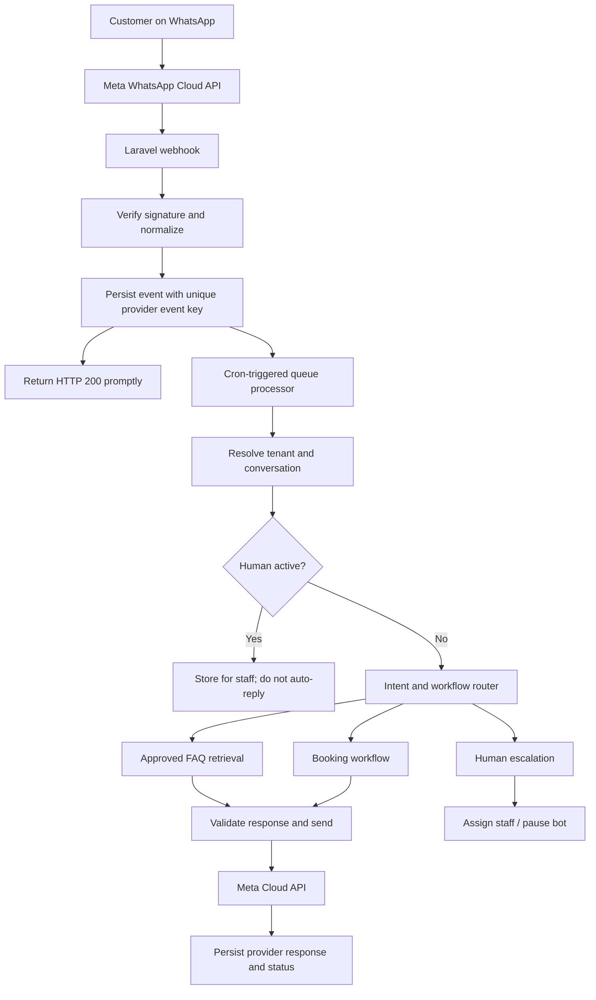
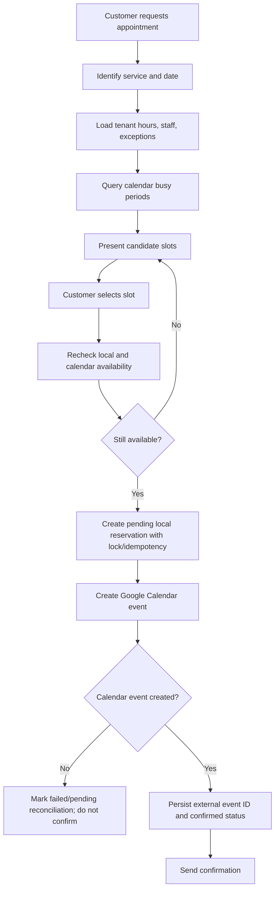

# System Architecture

## 1. Architecture decision

Use a **modular monolith**: one Laravel application with bounded modules and explicit interfaces. This is the simplest maintainable starting point for one developer and a Hostinger shared-hosting deployment. Extracting services is not justified until measured scale or operational needs require it.

### Initial stack

| Layer | Choice | Notes |
|---|---|---|
| Backend | Laravel / PHP | Version selected against Hostinger PHP support during bootstrap |
| Frontend | React + TypeScript + Inertia.js | Compiled static assets served by Laravel/Hostinger |
| Database | Neon PostgreSQL | Primary system of record; TLS required |
| Queue | Laravel database queue | Cron-triggered bounded processing; no always-on worker assumption |
| Cache/session | Database or file-backed initially | Avoid assuming Redis exists |
| AI | Groq adapter | Behind provider-neutral interface |
| Messaging | Meta WhatsApp Cloud API | Official API only |
| Calendar | Google Calendar API | OAuth and FreeBusy/events |
| Scheduler | Hostinger cron | Small bounded invocations; verify actual cron limits |
| Hosting | Hostinger Business | Shared hosting constraints apply |
| Vercel | Not used | Explicitly excluded from architecture |

## 2. Logical components

1. **HTTP/API layer:** authentication, validation, rate limits, webhook endpoints, dashboard routes.
2. **Tenant context:** resolves tenant membership or verified integration ownership; provides scoped access.
3. **Business configuration:** profiles, hours, holidays, services, staff, policies, FAQs.
4. **WhatsApp adapter:** webhook verification, signature validation, payload normalization, outbound API calls.
5. **Conversation engine:** customer resolution, message persistence, intent routing, state transitions.
6. **Knowledge service:** tenant-filtered FAQ and approved business data retrieval.
7. **AI orchestration:** provider manager, intent detector, response generation, validator, allowlisted tools.
8. **Human handover:** assignment and automation pause/resume gate.
9. **Booking domain:** slot calculation, reservation lifecycle, concurrency controls.
10. **Calendar adapter:** Google OAuth, FreeBusy, event CRUD, reconciliation.
11. **Queue and scheduler:** durable jobs, retries, reminders, cleanup, reconciliation.
12. **Administration and reporting:** tenant management, usage, integration and queue health, audit trail.

## 3. Message flow

The webhook must not call Groq or Google Calendar synchronously. It should validate, persist durably, and acknowledge. The scheduled processor works through bounded batches. If Hostinger cron cadence is insufficient for acceptable response latency, the deployment runtime must change; do not hide this limitation.

## 4. Booking flow

Because PostgreSQL and Google Calendar cannot participate in one distributed transaction, implement a recoverable state machine and reconciliation process. If event creation succeeds but local persistence fails, retry/reconcile using a stable operation key and event metadata. If local reservation succeeds but event creation fails, release or expire the hold and do not tell the customer it is confirmed.

## 5. Tenant isolation model

- Shared PostgreSQL database and schema; every tenant-owned row has `tenant_id`.
- All tenant-owned foreign keys should include tenant identity where practical, e.g. unique `(tenant_id, id)` and composite references.
- Resolve tenant from authenticated membership or verified WhatsApp phone-number/WABA mapping.
- Use explicit tenant-scoped repositories/query scopes and policies.
- Never accept tenant_id from customer-facing payloads as authority.
- Queue payloads include tenant identity for routing, but the worker revalidates resource ownership from the database.
- Consider PostgreSQL Row Level Security as defense-in-depth only after connection/session tenant context is safely implemented and tested. Application authorization remains mandatory.
- Add cross-tenant negative tests for every resource family.

## 6. Shared-hosting runtime design

Hostinger Business shared hosting is not assumed to provide:
- persistent Laravel queue workers,
- Redis,
- Docker,
- WebSockets,
- arbitrary long-running daemons.

Therefore:
- Use Laravel database queue and cron to invoke bounded processing commands.
- Each invocation processes a limited number of jobs or a time-bounded batch and exits.
- Use short webhook execution and durable persistence.
- Use database-backed locks/leases and unique jobs to avoid concurrent duplicate processing.
- Keep reminders and reconciliation in scheduled commands.
- Avoid large synchronous tasks in HTTP requests.
- Verify process limits, cron frequency, request timeout, PHP extensions, and outbound API access in hPanel.

Cron-based processing trades infrastructure simplicity for latency and throughput limits. It is an initial deployment strategy, not a promise of real-time always-on execution.

## 7. Failure and recovery patterns

- Webhook duplicates: unique provider event key and idempotent handler.
- Transient API failures: bounded exponential backoff with jitter.
- Permanent failures: failed state, alert/dashboard visibility, safe manual retry.
- AI provider unavailable: deterministic flow or human handover.
- Calendar partial failure: appointment state machine and reconciliation.
- Human takes over while a bot job is queued: recheck handover state immediately before outbound send.
- Outbound API timeout: persist attempt state and reconcile provider message ID/status; avoid blind duplicate sends.

## 8. Future portability

Keep queue execution behind Laravel's queue contracts and integration adapters behind application interfaces. A future VPS can run a persistent worker and Redis if justified, without changing tenant/domain logic. This is a future option, not part of the current approved stack.
